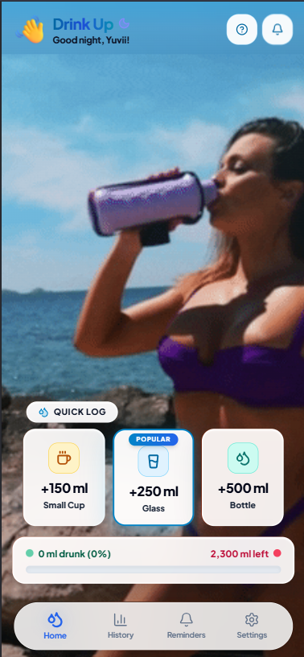
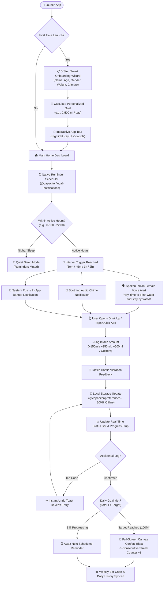
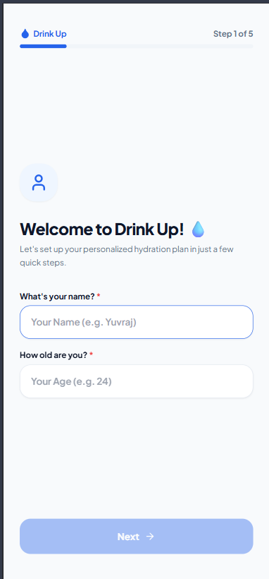
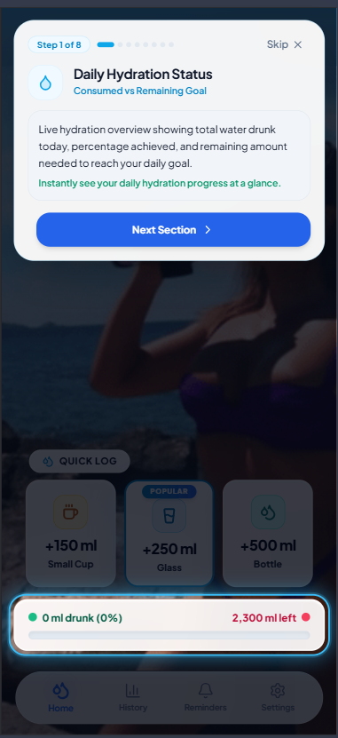
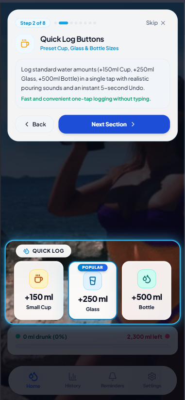
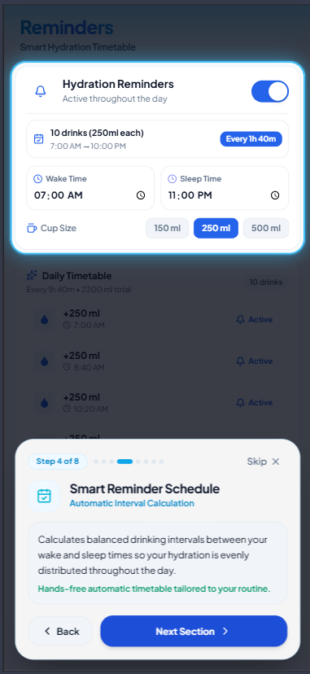
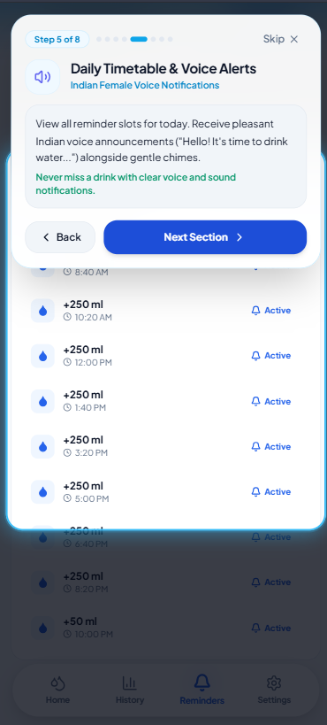

# 💧 Drink Up - Smart Hydration Tracker & Reminder App

<div align="center">

### *Stay Healthy • Stay Energised • Stay Hydrated* 🌊

[](https://github.com/SINGH0883/Drink-Up)
[](https://capacitorjs.com)
[](https://react.dev)
[](https://www.typescriptlang.org/)
[](https://tailwindcss.com/)
[](https://vitejs.dev/)
[](https://github.com/SINGH0883/Drink-Up/raw/main/drink-up.apk)
[](LICENSE)

<br />

[📥 **Download Android APK (5.29 MB)**](https://github.com/SINGH0883/Drink-Up/raw/main/drink-up.apk) • [✨ **Explore Features**](#-key-features) • [🏠 **Home Page**](#-home-page--interface-breakdown) • [🔄 **Workflow**](#-application--hydration-workflow) • [🛠️ **Developer Setup**](#-developer-guide--local-setup)

</div>

---

## 📖 Table of Contents

- [About Drink Up](#-about-drink-up)
- [Key Features](#-key-features)
- [Home Page & Interface Breakdown](#-home-page--interface-breakdown)
- [Application & Hydration Workflow](#-application--hydration-workflow)
- [App Preview & Visual Showcase](#-app-preview--visual-showcase)
- [Tech Stack](#-tech-stack)
- [Project Architecture & Structure](#-project-architecture--structure)
- [Developer Guide & Local Setup](#-developer-guide--local-setup)
- [Building the Android APK](#-building-the-android-apk)
- [APK Optimization & Size Strategy](#-apk-optimization--size-strategy)
- [Configuration & Settings](#-configuration--settings)
- [Contributing](#-contributing)
- [License](#-license)

---

## 📱 About Drink Up

**Drink Up** is a smart, ultra-lightweight hydration companion and reminder application engineered to build and maintain healthy daily drinking habits. Crafted with modern web technologies (**React 19**, **TypeScript**, **Tailwind CSS**) and packaged natively using **Capacitor 7**, Drink Up combines smooth glassmorphic UI, rich fluid animations, dynamic progress rings, expressive Indian female voice notifications, personalized hydration algorithms, and detailed analytics into an ultra-lean **5.29 MB Android APK**.

Whether you are working at your desk, exercising, or on the move, Drink Up guarantees you never miss your daily hydration targets with smart scheduling that respects your sleep cycles.

---

## ✨ Key Features

### 💎 1. Ultra HD Glassmorphism UI & Dynamic Fluid Animations
- **3D Liquid Orb & Water Wave Animation**: Dynamic rising water level with smooth wave graphics reacting in real time as you log intake.
- **Dual-Color Hydration Progress Ring**: High-precision circular gauge with green completed arc and red remaining goal indicator.
- **Micro-Bubbles & Splash FX**: Tactile haptic feedback accompanied by floating volume increments (+150ml, +250ml, +500ml).
- **Celebration Confetti**: Full-screen particle confetti bursts upon achieving 100% of your daily hydration goal.

### 🧭 2. Interactive App Tour & Smooth Onboarding
- **Step-by-Step Guided Tour**: Visual interactive walkthrough (`AppTour`) highlighting key UI elements for new users.
- **Smart Hydration Setup Wizard**: Calculates your baseline intake requirement based on weight, activity level, and climate conditions.

### 🗣️ 3. Indian Female Voice Alerts & Multi-Modal Reminders
- **Human-Like Voice Guidance**: Natural Indian female voice prompts (*"Hey, it's time to drink water and stay hydrated!"*) paired with soothing notification chimes.
- **Flexible Interval Scheduling**: Set reminders every 30 mins, 45 mins, 1 hour, 1.5 hours, 2 hours, or 3 hours.
- **Custom Time Slots**: Pinpoint exact daily reminder times matching your personal schedule.
- **Quiet Sleep Hours**: Automatically silences reminders between your designated bedtime and wake-up times.
- **In-App Reminder Banners & Native Push Notifications**: Seamless notifications whether the app is in the foreground, background, or closed.

### ⚡ 4. Fast Quick-Log & Precision Entry
- **One-Tap Quick Log Presets**: Pre-configured buttons for standard drinking glasses (150ml, 250ml, 500ml).
- **Custom Volume Slider & Modal**: Precise volume entry for water bottles, mugs, or custom containers.
- **Instant Undo Toast**: Floating revert toast with timer to instantly cancel accidental logs.

### 📈 5. Detailed Analytics & Consecutive Streak Tracker
- **Interactive Weekly Bar Charts**: Visual breakdown of your daily consumption against target goals over the last 7 days.
- **Daily Timestamped History**: Chronological log of each drink entry with volume, time, and removal options.
- **Streak Tracker & Best Record**: Tracks consecutive target completions with motivational badge tiers to keep you committed.

### 🌓 6. Customization & Offline-First Persistence
- **Light & Dark Theme Engine**: Seamless automatic or manual switching between sleek dark and crisp light themes.
- **Unit Flexibility**: Full support for Metric (`ml`) and Imperial (`fl oz`) units.
- **100% Offline Support**: Local persistence powered by `@capacitor/preferences` — zero account registration required, keeping all your personal health data private on your device.

---

## 🏠 Home Page & Interface Breakdown

The **Drink Up Home Page** is designed with a mobile-first, high-focus UX that combines rich glassmorphic aesthetics, fluid animated wave dynamics, and lightning-fast one-tap actions.

<div align="center">
  
  <p><sub><b>Drink Up Live Home Screen:</b> Dynamic Greeting, Animated Water Canvas, Quick-Log Hub, and Two-Tone Status Bar</sub></p>
</div>

```
┌─────────────────────────────────────────────────────────────┐
│ 💧 Drink Up - Mobile Home Screen Dashboard                  │
├─────────────────────────────────────────────────────────────┤
│                                                             │
│  [👋] Drink Up 🌙 Good night, Yuvii!     [🔥 3d] [❓] [🔔]  │
│       Rest well and stay hydrated for tomorrow.             │
│                                                             │
├─────────────────────────────────────────────────────────────┤
│                                                             │
│                🌊 LIVE FLUID HYDRATION CANVAS 🌊            │
│            (Dynamic rising water & ambient waves)           │
│                                                             │
│                                                             │
│   ┌─────────────────────────────────────────────────────┐   │
│   │ ⚡ Quick-Log Intake Presets                         │   │
│   │ ┌───────────────┐ ┌───────────────┐ ┌─────────────┐ │   │
│   │ │    +150 ml    │ │    +250 ml    │ │   +500 ml   │ │   │
│   │ │   Small Cup   │ │  Glass (POP)  │ │   Bottle    │ │   │
│   │ └───────────────┘ └───────────────┘ └─────────────┘ │   │
│   └─────────────────────────────────────────────────────┘   │
│                                                             │
│   ┌─────────────────────────────────────────────────────┐   │
│   │ 🟢 0 ml drunk (0%)                 2,300 ml left 🔴 │   │
│   │ ═══════════════════════════════════─────────────── │   │
│   │ [=== Dynamic Emerald-to-Sky Progress Fill ===]      │   │
│   └─────────────────────────────────────────────────────┘   │
│                                                             │
│   ┌─────────────────────────────────────────────────────┐   │
│   │ ↩️ Logged +250 ml • Tap to Undo                 (3s)│   │
│   └─────────────────────────────────────────────────────┘   │
│                                                             │
├─────────────────────────────────────────────────────────────┤
│    [ 💧 Home ]     [ 📊 History ]    [ ⏰ Alerts ]   [ ⚙️ Settings ] │
└─────────────────────────────────────────────────────────────┘
```

### 🧩 Home Page Component Highlights

| Component | Architecture & Role | Visual & UX Behavior |
| :--- | :--- | :--- |
| **👋 Dynamic Header** | `HomePage.tsx` + `waving-hand-3d.png` | Adapts greeting automatically (*Morning, Afternoon, Evening, Night*), displays current streak badge (`🔥 Xd`), interactive tour guide trigger (`❓`), and quick reminder settings shortcut (`🔔`). |
| **🌊 Fluid Water Canvas** | `hydrate-bg.gif` / `hydrate-bg.webp` | Full-screen background animation with gradient overlay creating an immersive, calm hydration atmosphere. |
| **⚡ Quick-Log Hub** | `QuickAddButtons.tsx` | Instant 1-tap logging for 150ml, 250ml, and 500ml with tactile haptic vibration pulses (`@capacitor/haptics`). |
| **🎛️ Custom Volume Modal** | `CustomAddModal.tsx` | Precision slider and quick-chip selector allowing exact volume logs for custom water bottles or mugs. |
| **📊 Two-Tone Status Bar** | `tour-status-bar` in `HomePage.tsx` | Real-time dual indicator displaying completed intake (green pulsating dot) versus remaining goal (rose dot) with a smooth gradient progress fill. |
| **↩️ Instant Undo Toast** | `UndoToast.tsx` | Non-intrusive floating toast with countdown timer to effortlessly revert accidental water entries. |
| **🧭 1-Finger Gesture Nav** | `App.tsx` gesture listener | Smooth horizontal swipe gestures (Left/Right) allowing effortless one-handed switching across tabs. |

---

## 🔄 Application & Hydration Workflow

The following flowchart illustrates the complete user lifecycle, smart scheduling, voice prompting, and offline persistence flow within **Drink Up**:



### 🔁 Workflow Stages Explained

1. **Intelligent Setup & Goal Calibration**  
   New users are greeted with a frictionless 5-step onboarding wizard. By factoring in body weight, climate temperature, and daily physical activity level, the app calculates an optimal daily hydration baseline in milliliters or fluid ounces.
2. **Smart Active-Hour Reminder Engine**  
   Reminders are scheduled natively using `@capacitor/local-notifications`. The smart scheduler strictly observes designated wake and sleep windows (e.g., 07:00 to 22:00) so users are never disturbed during quiet rest hours.
3. **Multi-Sensory Indian Voice Prompts**  
   Unlike generic robotic beeps, Drink Up pairs soothing notification audio with expressive spoken Indian female voice guidance (*"Hey, it's time to drink water and stay hydrated!"*) along with gentle tactile vibration feedback.
4. **Frictionless Quick-Logging & Safety Buffer**  
   Users log water in seconds via calibrated quick-add presets (`150ml`, `250ml`, `500ml`) or custom volume sliders. An active **Undo Toast** appears for several seconds to allow immediate one-tap reversal if a quantity is entered mistakenly.
5. **Gamified Streaks, Confetti & Weekly Analytics**  
   Upon reaching 100% of the daily goal, celebratory confetti cascades across the screen and consecutive active streak counters advance. All logs are stored securely offline on the device using `@capacitor/preferences` and charted across a 7-day interactive history.

---

## 📱 App Preview & Visual Showcase

A glimpse into the sleek UI, guided onboarding, and hands-free hydration reminder experience in **Drink Up**:

<div align="center">

| 📋 Onboarding Wizard | 🏠 Home Dashboard | 📊 Daily Hydration Status |
| :---: | :---: | :---: |
|  |  |  |
| **Step 1/5: Setup Wizard**<br/>Personalized intake calculation by age & weight | **Home Dashboard**<br/>Live water tracking, waving greeting & quick presets | **Step 1/8: Status Tour**<br/>Real-time drunk vs remaining goal tracker |

| ⚡ Quick Log Presets | ⏰ Smart Reminder Schedule | 🗣️ Voice Alerts & Timetable |
| :---: | :---: | :---: |
|  |  |  |
| **Step 2/8: Quick Log**<br/>One-tap logging (+150ml, +250ml, +500ml) | **Step 4/8: Smart Reminders**<br/>Automatic wake/sleep interval timetable | **Step 5/8: Spoken Voice Alerts**<br/>Indian female voice & chime timetable |

</div>

### 🌟 Key UX Highlights

| Feature | Description |
| :--- | :--- |
| **🌊 Live Wave Background** | Smooth, calming water visuals with real-time gradient overlays. |
| **📊 Two-Tone Status Bar** | Dual-colored live strip displaying exact volume drunk versus remaining target at a glance. |
| **👋 Time-Aware Greeting** | Dynamic time-of-day greetings (*Morning, Afternoon, Evening, Night*) with streak flame counter. |
| **⏰ Hands-Free Timetable** | Automatically calculates balanced drinking intervals based on wake and bedtime routines. |
| **🗣️ Spoken Voice Guidance** | Natural Indian female voice prompts paired with gentle notification chimes. |
| **🏆 Confetti Milestones** | Interactive celebratory confetti cascades rewarding 100% daily goal completions. |

---

## 🛠️ Tech Stack

### Frontend & Core
- **Framework**: [React 19](https://react.dev/) + [TypeScript 5.7](https://www.typescriptlang.org/)
- **Build Tool**: [Vite 6](https://vitejs.dev/)
- **Styling**: [Tailwind CSS 3.4](https://tailwindcss.com/) with PostCSS & CSS3 Keyframe Animations
- **Icons**: [Lucide React](https://lucide.dev/)
- **Visual Effects**: [canvas-confetti](https://www.npmjs.com/package/canvas-confetti)

### Native Mobile Bridge (Capacitor 7)
- **`@capacitor/core` & `@capacitor/android`**: Native runtime bridging web and Android layers.
- **`@capacitor/local-notifications`**: Native scheduled background push alerts.
- **`@capacitor/haptics`**: Precise tactile vibration feedback.
- **`@capacitor-community/text-to-speech`**: Voice synthesis for spoken reminder prompts.
- **`@capacitor/status-bar` & `@capacitor/splash-screen`**: Native Android system bar and startup styling.
- **`@capacitor/preferences`**: High-performance persistent key-value storage.

---

## 📂 Project Architecture & Structure

```
Drink-Up/
├── android/                         # Native Android Studio Capacitor project
│   ├── app/                         # Android application module & manifest
│   └── gradle/                      # Gradle wrapper configuration
├── public/                          # Static web assets, icons & media
│   ├── screenshots/                 # Application UI previews & tour screenshots
│   │   ├── home-dashboard.png       # Live mobile home dashboard
│   │   ├── onboarding-wizard.png    # Setup wizard & target calculator
│   │   ├── reminders-schedule.png   # Smart schedule & timetable settings
│   │   ├── tour-daily-status.png    # Real-time hydration status tour
│   │   ├── tour-quick-log.png       # Quick log presets tour
│   │   └── voice-alerts-timetable.png # Indian female voice alerts timetable
│   ├── hydrate-bg.webp              # HD background texture
│   └── circle-water.gif             # Wave animation asset
├── src/
│   ├── components/                  # Modular React UI components
│   │   ├── common/                  # AppTour, Header, InAppNotificationBanner, Switch
│   │   ├── history/                 # StreakCard, TodayEntriesList, WeeklyBarChart
│   │   ├── home/                    # WaterRing, QuickAddButtons, CustomAddModal, UndoToast
│   │   ├── navigation/              # Bottom navigation bar & routing tabs
│   │   └── reminders/               # ScheduleTimeline & reminder managers
│   ├── hooks/                       # Custom hooks (useHydration, useNotifications, useSettings)
│   ├── lib/                         # Native wrappers (audio, haptics, notifications, storage)
│   ├── pages/                       # Screen views (HomePage, HistoryPage, RemindersPage, SettingsPage)
│   ├── styles/                      # Tailwind utilities & fluid wave animation stylesheets
│   ├── types/                       # TypeScript interfaces, types & presets
│   ├── App.tsx                      # Root application layout & state orchestrator
│   └── main.tsx                     # React application entry point
├── drink-up.apk                     # Pre-compiled standalone Android APK (5.29 MB)
├── capacitor.config.ts              # Capacitor native configuration
├── tailwind.config.js               # Tailwind design system tokens
├── tsconfig.json                    # TypeScript compiler configuration
├── vite.config.ts                   # Vite bundler configuration
└── package.json                     # Project dependencies and npm scripts
```

---

## 💻 Developer Guide & Local Setup

Follow these steps to run Drink Up locally on your machine or test it in an Android emulator.

### 📋 Prerequisites
- **Node.js**: `v18.x` or higher (LTS recommended)
- **Package Manager**: `npm`, `yarn`, or `pnpm`
- **Android Studio** *(for mobile development)*: Android SDK 34+ and command-line tools installed.

### 🚀 1. Clone & Install Dependencies
```bash
# Clone the repository
git clone https://github.com/SINGH0883/Drink-Up.git

# Navigate into project root
cd Drink-Up

# Install dependencies
npm install
```

### 🌐 2. Run Web Development Server
```bash
npm run dev
```
Open [http://localhost:5173](http://localhost:5173) in your browser to test the web interface.

### 📱 3. Sync & Run on Android
```bash
# Build production web bundle
npm run build

# Sync assets and plugins to the native Android project
npx cap sync android

# Open project in Android Studio
npx cap open android
```
From Android Studio, click **Run 'app'** to launch on a connected physical device or emulator.

---

## 📦 Building the Android APK

To generate a standalone APK directly from your terminal:

```bash
# 1. Build optimized web assets
npm run build

# 2. Synchronize web bundle with Android
npx cap sync android

# 3. Build APK using Gradle Wrapper (Windows PowerShell)
cd android
./gradlew assembleRelease
# Or for debug APK:
# ./gradlew assembleDebug
```

The compiled APK will be output to:
```
android/app/build/outputs/apk/release/app-release-unsigned.apk
# or
android/app/build/outputs/apk/debug/app-debug.apk
```

---

## ⚡ APK Optimization & Size Strategy

Drink Up has been optimized to maintain a lightweight footprint (**5.29 MB**):
- **Targeted ABI Architecture**: ARM64-v8a target compilation avoids bundling duplicate 32-bit native libraries.
- **R8 / ProGuard Shrinking**: Dead code elimination and tree-shaking across Java/Kotlin dependencies.
- **Asset Compression**: WebP image encoding and vector SVG icons minimize bundle bloat.
- **Modular Native Imports**: Only required Capacitor modules are included.

---

## ⚙️ Configuration & Settings

| Setting | Options | Default | Description |
| :--- | :--- | :--- | :--- |
| **Unit System** | `ml` / `fl oz` | `ml` | Preferred volume measurement unit |
| **Daily Goal** | `1000ml` - `5000ml` | `2500ml` | Configurable directly or via calculator |
| **Reminder Interval** | `30m`, `45m`, `1h`, `1.5h`, `2h`, `3h` | `1h` | Frequency of scheduled background alerts |
| **Voice Style** | `Indian Female`, `Default` | `Indian Female` | Speech voice for spoken alerts |
| **Sound Alert** | `Enabled` / `Disabled` | `Enabled` | Notification chime playback |
| **Haptic Feedback** | `Enabled` / `Disabled` | `Enabled` | Vibration pulses on logging and actions |
| **Active Hours** | Custom Wake & Sleep times | `07:00` - `22:00` | Sleep quiet period filtering |

---

## 🤝 Contributing

Contributions, issues, and feature requests are welcome!

1. **Fork the Repository**
2. **Create a Feature Branch** (`git checkout -b feature/AmazingFeature`)
3. **Commit Your Changes** (`git commit -m 'feat: add amazing new feature'`)
4. **Push to the Branch** (`git push origin feature/AmazingFeature`)
5. **Open a Pull Request**

---

## 📄 License

This project is licensed under the [MIT License](LICENSE) - see the [LICENSE](LICENSE) file for details.

---

<div align="center">

Crafted with 💙 by **[SINGH0883](https://github.com/SINGH0883)**

*Don't forget to ⭐ star the repo if you find Drink Up helpful!*

</div>
